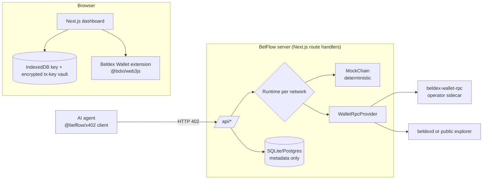

# BelFlow Protocol architecture

**Audience:** Beldex maintainers and integrators who know CryptoNote/RingCT.

## 1. Why Beldex's UTXO model fits payroll and compliance

Every Beldex output goes to a one-time stealth address, sits in a ring of 10 (9 decoys), and hides its amount in a Pedersen commitment. Privacy Tokens (Proto, HF 22 at testnet height 4,242,200; `Beldex-Coin/beldex@feature-privacy-token`) extend the same model with `tx_out_zyphora` outputs, whose token id is blinded per output. For a company this means three things:

- **Treasury balance:** not derivable from the chain.
- **Payee graph:** not linkable; each employee output is a fresh stealth address.
- **Amounts:** hidden, but provable one output at a time with the transaction secret key (`tx_key`) through `check_tx_key`, which reports BDX in `received` and tokens in `token_received`.

BelFlow builds on that last point. Disclosure is selective by construction, at the granularity of a single output.

## 2. Components



### Providers (`@belflow/sdk`)

All three implement `IBeldexProvider` and declare `capabilities`. The UI hides actions a provider cannot do.

| Provider | Backed by | Multi-output | tx keys | Privacy Tokens | Used for |
|---|---|---|---|---|---|
| `ExtensionProvider` | `@bdxi/web3js` 1.0.x | no | no | no | Login signatures, single BDX checkout |
| `WalletRpcProvider` | `beldex-wallet-rpc` (`feature-privacy-token` build) | yes (`transfer`, `transfer_split`) | yes | yes (`register_privacy_token`, `mint_token`, `burn_token`, `update_token`) | Treasury, payroll, proofs, agent payer |
| `MockTestnetProvider` | `MockChain` (in-process or over `/api/rpc`) | yes | yes | yes | Offline demo, CI, E2E |

`MockChain` models what matters for correctness:

- UTXOs per asset.
- Change outputs locked for `DEFAULT_TX_SPENDABLE_AGE_V17 = 2` blocks.
- Flash transactions in the mempool until mined.
- Fees with a burned flash surcharge.
- BNS records and per-account signatures.

The same seed and call sequence produce the same hashes, keys and addresses.

## 3. Key flows

### Payroll (idempotent)

1. **Client.** The browser parses the CSV, resolves every `.bdx` name through the server, and shows the batch plan: one asset per tx, at most 15 recipients, plus change.
2. **Job.** `POST /api/treasury/payroll` carries an idempotency key and the payload. The server stores only the payload hash and per-chunk bookkeeping (`PayrollBatchJob`), never the recipients or amounts.
3. **Claim.** The runner claims the job atomically, then re-reads it.
4. **Send.** For each pending chunk it writes `SUBMITTING`, calls `transfer` (falling back to `transfer_split` when the tx is too large), then writes `SENT` with the tx hashes.
5. **Failures.**
   - Locked change sets the job to `WAITING_UTXO_UNLOCK`.
   - A timeout raises `OutcomeUnknownError`, and the chunk becomes `UNKNOWN`.
   - A chunk left in `SUBMITTING` by a crash also becomes `UNKNOWN`.
   - `UNKNOWN` chunks are never resent automatically.
6. **Keys.** Tx keys are returned once. The browser encrypts them into its vault with a non-extractable AES-GCM key stored in IndexedDB.

### Selective audit proof

1. **Issue.** The operator picks a receipt in the vault. The browser encrypts the tx key with a fresh link key and sends the ciphertext plus, once, the plaintext key.
2. **Verify and sign.** The server verifies the payment (exact amount, token via `token_received`, confirmed), has the treasury sign `belflow-proof-v1|txHash|tokenId|amountAtomic|recipient`, and stores the canonical package with its SHA-256 hash and the ciphertext. The plaintext key is discarded.
3. **Link.** The auditor link is `/verify/<proofId>#k=<linkKey>`. The fragment never reaches the server.
4. **Re-verify.** The auditor's browser decrypts the key and calls `/api/audit/verify`, which re-runs `check_tx_key` (`token_received`) and the signature check live. It then shows "verified in block #N" with the `assetVerificationLevel`.

### x402 (HTTP 402 for agents)

```
Agent                                   API (withX402)                      Beldex
  | GET /api/x402/demo                    |                                    |
  |-------------------------------------->| nonce + issuedAtHeight stored      |
  |<-- 402 X-Beldex-Recipient/Amount/... -|                                    |
  | policy: network, cap, budget, BNS     |                                    |
  |   allowlist resolved by the agent     |                                    |
  | flash transfer --------------------------------------------------------->  |
  | GET + X-Beldex-Payment-Proof: txHash:txKey:agent.bdx + nonce               |
  |-------------------------------------->| verifyPayment (amount+asset), flash |
  |                                       |   0-conf only if daemon says flash  |
  |                                       | claim tx + consume nonce (atomic)  |
  |<-------------------------- 200 + data |                                    |
```

## 4. Threat model (summary)

| Threat | Mitigation |
|---|---|
| Token confusion (pay BDX or token A, claim token B) | `check_tx_key` `token_received` attributes each token; anything else paid to the address in the same tx, or a disagreement with the wallet-free zyphora decode, invalidates the payment. A daemon never attributes a token (blinded ids). |
| Replay of a payment proof | Single-use nonce scoped to path and network, plus a global `SettledTransaction` claim per tx hash |
| Old payment reused for a new call | `issuedAtHeight`: payments mined before the challenge are rejected |
| Misattributed invoice payment | One `create_address` subaddress per invoice |
| Double payroll payment | Idempotency key, `SUBMITTING`-before-broadcast, `UNKNOWN` never resent, re-read after claim |
| Phished login signature | Challenge bound to an httpOnly cookie. Statement includes origin, network, nonce and expiry. |
| Treasury data exposure | Testnet overview and all treasury routes require the operator session. API responses use `no-store`. |
| Server compromise leaks tx keys | Only client-encrypted ciphertext is stored, and the key lives in the link fragment |
| Proxy abuse | The testnet `/api/rpc` allowlist is read-only. No spend, sign or key export is exposed. |
| Token descriptor injection | The descriptor is sent inline (`register_privacy_token` `json_string`) from a strict schema; no file is shared with the wallet host |
| Malicious 402 server draining an agent | A mandatory agent spend policy, with BNS names resolved by the agent |

Known limits:

- The mock devnet is an open sandbox: no auth, public seed. It must not be exposed with real value.
- Rate limiting is in-memory per instance. Use a shared store in production.
- `ISSUER_SIGNED_DECLARATION` is accountability, not cryptographic attribution. See `BELDEX_CORE_RECOMMENDATIONS.md`.

## 5. Toward the 2027 EVM sidechain

The provider interface is the seam:

- An `EvmBridgeProvider` can implement `IBeldexProvider` for a future Beldex EVM: payroll in wrapped Privacy Tokens, with proofs that link a Beldex `tx_key` disclosure to a bridge mint event.
- `@belflow/x402` already separates the challenge protocol from settlement. An EVM settlement verifier is another `VerificationSources` implementation, with no change to the agent client.
- Audit packages are chain-agnostic JSON (`network`, `txHash`, `tokenId`, `amountAtomic`, `declaration`, `packageHash`). They can carry an EVM receipt alongside the RingCT proof.
